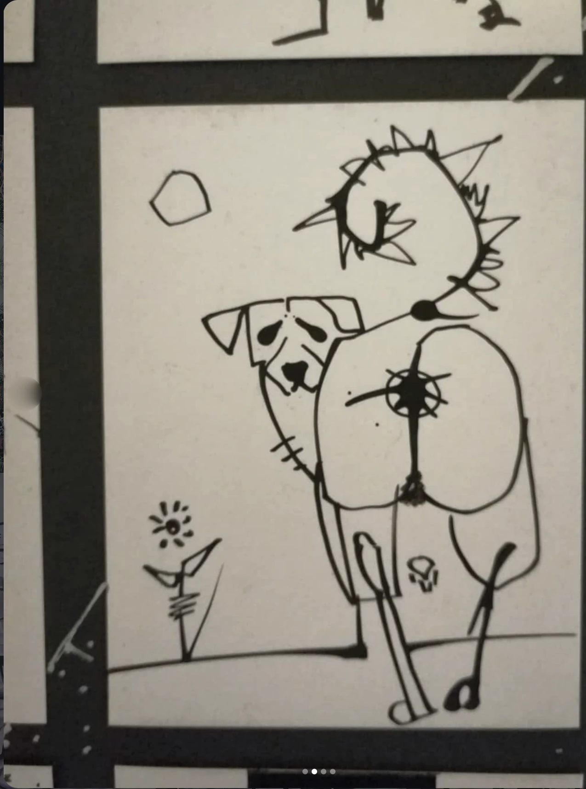

# ART-0029

## Observație Curatorială (Factuală)

Desen minuțios în grafit cu gradienți fini de umbrire. Focalizarea este plasată pe o structură centrală ce combină elemente de osteologie (vertebre, coaste, cavități craniene) cu elemente de transmisie mecanică (arcuri, balamale, conducte).

## Evaluare Critică (Interpretativă)

Maestria tehnică a hașurii conferă volum și tactilitate desenului, amintind de studiile anatomice renascentiste contaminate de imaginarul biomecanic al anilor 1980. Linia este precisă, fără ezitări, conturând o anatomie hibridă perfect funcțională la nivel imaginar.

## Date de Proveniență și Arhivă

- **Identificator:** `ART-0029`
- **Grup Postare Sursă:** `POST-0018` (Imaginea 2 din 6)
- **Captură Sursă:** `Pasted 2026-11-11 at 11.27.44 AM.png`
- **Statut Restaurare:** `retouched`
- **Notă Tehnică:** Restaurare prudentă efectuată: elementele de interfață Instagram (săgeată stânga=True, săgeată dreapta=True, puncte de carusel=True) au fost eliminate prin interpolare de textură perimetrală fără alterarea operei.
