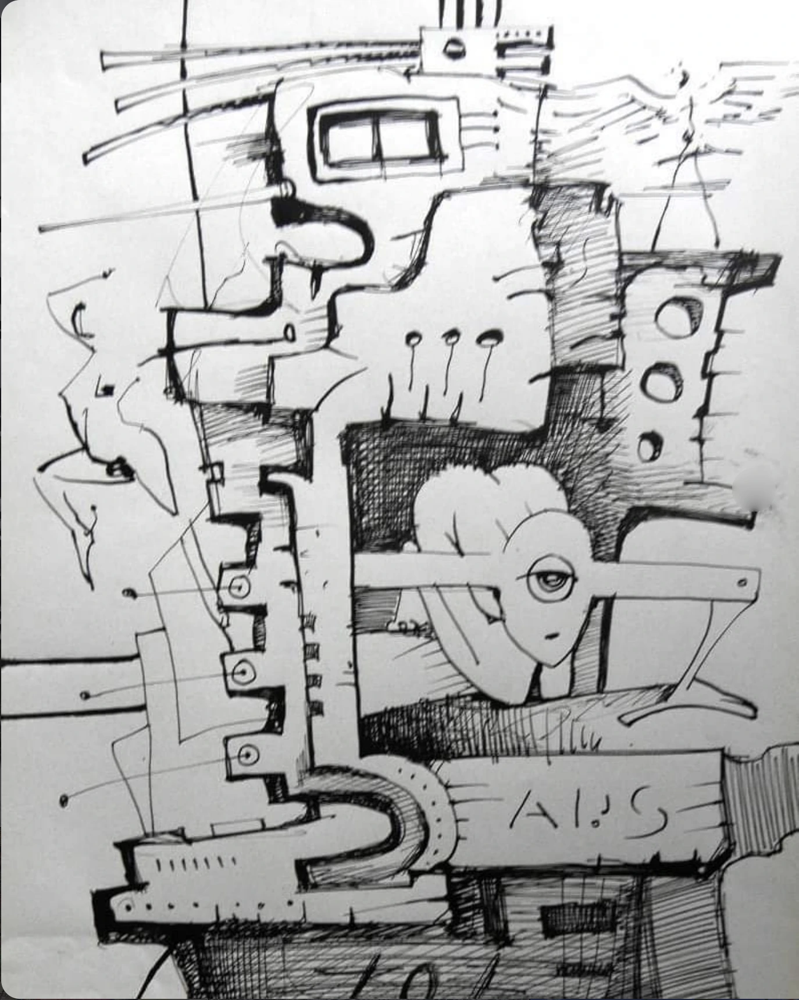

# Opus 757 — ART-0077

## Observație Curatorială (Factuală)

Compoziție sculpturală tridimensională instalată pe soclu cubic alb. Prezența platanelor reflectorizante de hard disk montate ca „ochi” sau „fețe” mecanice pe pistoane hidraulice articulate, susținute de încălțăminte umană uzată.

## Evaluare Critică (Interpretativă)

Tensiunea lucrării rezidă în antropomorfizarea violent-poetică a tehnologiei dezafectate. Artistul unește memoria biologică (pantoful de copil) cu memoria magnetică (discul rigid), generând un artefact post-industrial cu alură de totem animat.

## Date de Proveniență și Arhivă

- **Identificator:** `ART-0077`
- **Grup Postare Sursă:** `POST-0030` (Imaginea 8 din 19)
- **Captură Sursă:** `Pasted 2026-11-11 at 11.45.33 AM.png`
- **Statut Restaurare:** `retouched`
- **Notă Tehnică:** Restaurare prudentă efectuată: elementele de interfață Instagram (săgeată stânga=True, săgeată dreapta=True, puncte de carusel=True) au fost eliminate prin interpolare de textură perimetrală fără alterarea operei.
