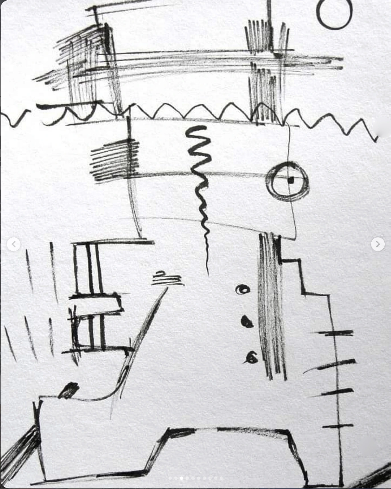

# ART-0080

## Observație Curatorială (Factuală)

Lucrare de format vertical pronunțat, structurată în benzi compoziționale paralele. Registrul superior prezintă litere și grafisme ermetice („WRIGHT”), registrul median include un medalion circular cu hașuri dense, iar registrul inferior dezvoltă o rețea de circuite/rune albe pe fond negru.

## Evaluare Critică (Interpretativă)

Compoziția reia tradiția coloanelor nesfârșite și a stelelor funerare arhaice, traduse într-un limbaj cyber-criptic. Registrele acționează ca straturi geologice ale cunoașterii, unde limbajul scris se dizolvă progresiv în semnal pur și schemă tehnologică.

## Date de Proveniență și Arhivă

- **Identificator:** `ART-0080`
- **Grup Postare Sursă:** `POST-0030` (Imaginea 11 din 19)
- **Captură Sursă:** `Pasted 2026-11-11 at 11.46.39 AM.png`
- **Statut Restaurare:** `retouched`
- **Notă Tehnică:** Restaurare prudentă efectuată: elementele de interfață Instagram (săgeată stânga=True, săgeată dreapta=True, puncte de carusel=True) au fost eliminate prin interpolare de textură perimetrală fără alterarea operei.
