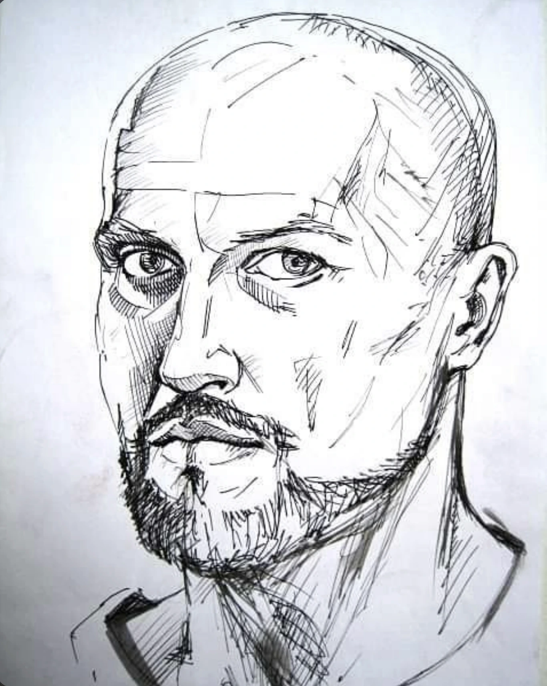

# ART-0103

## Observație Curatorială (Factuală)

SCANNER // DIAGNOSTIC IDENTITATE
Subiect: Ființă umană.
Status: Activ. Operează în afara algoritmilor standard.
Clasificare: Unicat (exemplar nereplicabil, fără copie de rezervă).

## Evaluare Critică (Interpretativă)

Arhitectură internă: Între inginerie de precizie și anatomie emoțională. Nu produce obiecte, ci mecanisme care simt. Lucrează la intersecția unde linia rece a schiței tehnice întâlnește imperfecțiunea caldă a materiei vii. Pentru el, desenul nu este decor, ci o disecție a logicii interne din spatele lucrurilor, o încercare de a cartografia felul în care funcționează o idee înainte de a primi formă fizică.

Fiecare lucrare din arhivă este un prototip: o urmă de grafit, un fragment de hardware, o tensiune mecanică sau o întrebare lăsată intenționat deschisă. Fără artificii, fără compromisuri estetice, doar structură pură și observație lucidă.

## Date de Proveniență și Arhivă

- **Identificator:** `ART-0103`
- **Grup Postare Sursă:** `POST-0035` (Imaginea 1 din 2)
- **Captură Sursă:** `Pasted 2026-11-11 at 11.56.01 AM.png`
- **Statut Restaurare:** `retouched`
- **Notă Tehnică:** Restaurare prudentă efectuată: elementele de interfață Instagram (săgeată stânga=False, săgeată dreapta=False, puncte de carusel=True) au fost eliminate prin interpolare de textură perimetrală fără alterarea operei.
