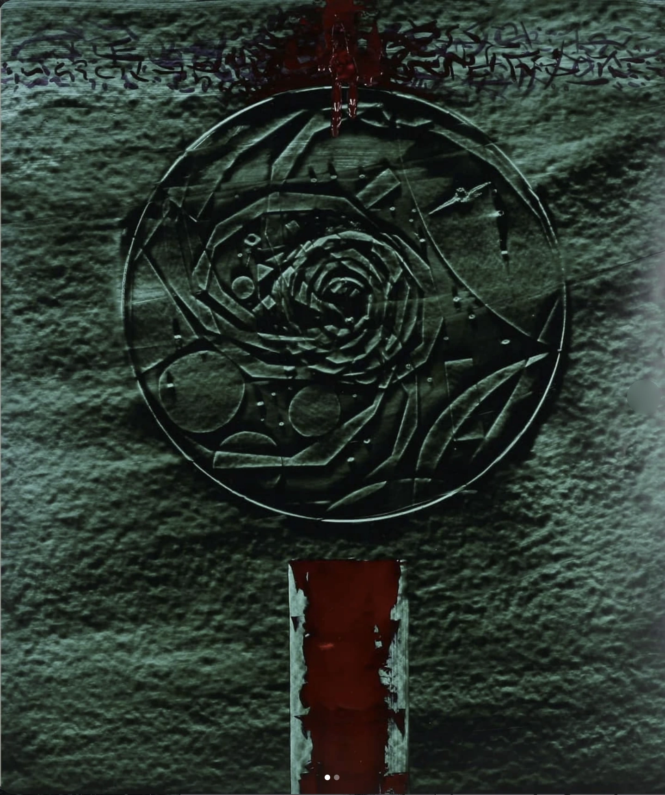

# Opus 757 — ART-0124

## Observație Curatorială (Factuală)

Suprafață picturală activată cromatic prin contraste între tonuri calde de teracotă/rugină și accente reci de turcoaz sau ocru mineral. Formele geometrice angulare intersectează arabescuri organice și texturi pulverizate.

## Evaluare Critică (Interpretativă)

Introducerea culorii nu are rol decorativ, ci funcționează ca vector de tensiune spațială. Cromaticul fragmentează planul imaginii, creând o dinamică cubisto-futuristă ce contrapunctează rigoarea desenului monocrom.

## Date de Proveniență și Arhivă

- **Identificator:** `ART-0124`
- **Grup Postare Sursă:** `POST-0049` (Imaginea 2 din 2)
- **Captură Sursă:** `Pasted 2026-11-11 at 12.03.42 PM.png`
- **Statut Restaurare:** `retouched`
- **Notă Tehnică:** Restaurare prudentă efectuată: elementele de interfață Instagram (săgeată stânga=True, săgeată dreapta=True, puncte de carusel=True) au fost eliminate prin interpolare de textură perimetrală fără alterarea operei.
