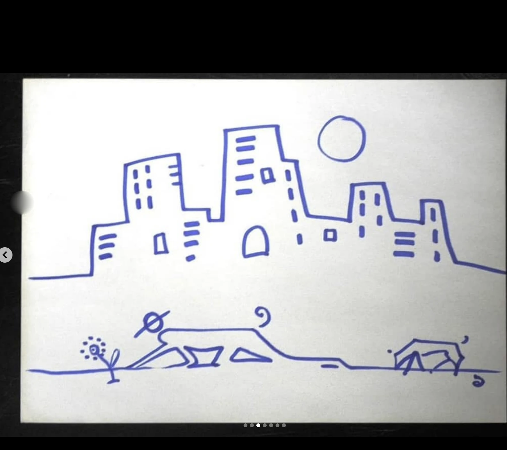

# ART-0135

## Observație Curatorială (Factuală)

Viziune spațială monumentală, amintind de planurile utopice ale lui Lebbeus Woods și Piranesi. Linii axonometrice riguroase se împletesc cu bolți biomecanice și caverne structurale.

## Evaluare Critică (Interpretativă)

Lucrarea explorează arhitectura ca organism viu, claustrofobic și maiestuos în același timp. Punctele multiple de fugă destabilizează privitorul, forțându-l să navigheze un labirint fără ieșire, dar guvernat de o geometrie matematică impecabilă.

## Date de Proveniență și Arhivă

- **Identificator:** `ART-0135`
- **Grup Postare Sursă:** `POST-0057` (Imaginea 1 din 1)
- **Captură Sursă:** `Pasted 2026-11-11 at 12.07.21 PM.png`
- **Statut Restaurare:** `cropped`
- **Notă Tehnică:** Cleanly cropped to remove Instagram desktop sidebar and container borders.
