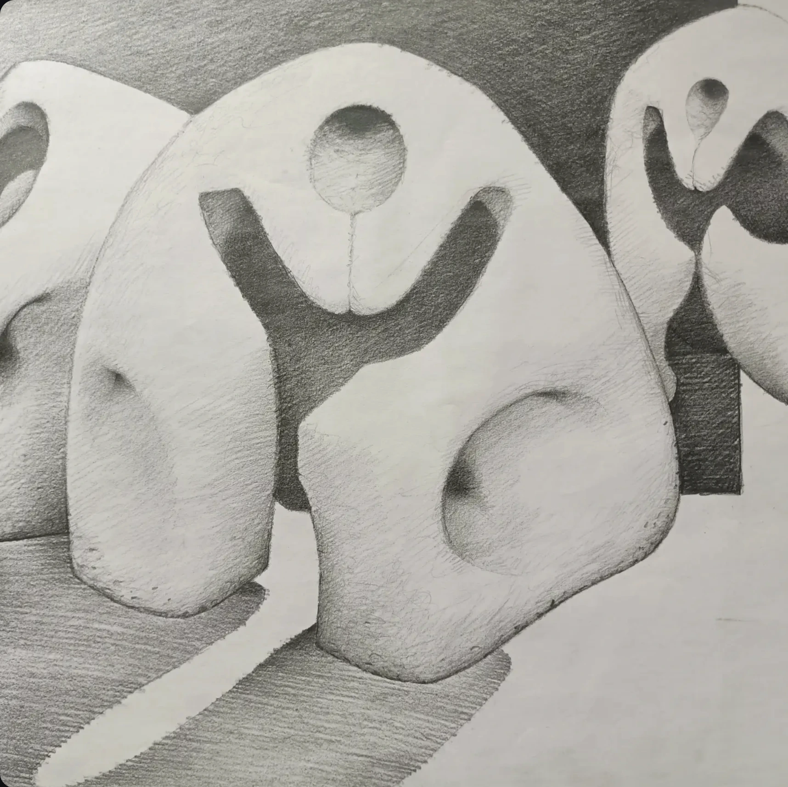

# Opus 757 — ART-0165

## Observație Curatorială (Factuală)

Viziune spațială monumentală, amintind de planurile utopice ale lui Lebbeus Woods și Piranesi. Linii axonometrice riguroase se împletesc cu bolți biomecanice și caverne structurale.

## Evaluare Critică (Interpretativă)

Lucrarea explorează arhitectura ca organism viu, claustrofobic și maiestuos în același timp. Punctele multiple de fugă destabilizează privitorul, forțându-l să navigheze un labirint fără ieșire, dar guvernat de o geometrie matematică impecabilă.

## Date de Proveniență și Arhivă

- **Identificator:** `ART-0165`
- **Grup Postare Sursă:** `POST-0076` (Imaginea 3 din 5)
- **Captură Sursă:** `Pasted 2026-11-11 at 12.32.35 PM.png`
- **Statut Restaurare:** `retouched`
- **Notă Tehnică:** Restaurare prudentă efectuată: elementele de interfață Instagram (săgeată stânga=True, săgeată dreapta=True, puncte de carusel=True) au fost eliminate prin interpolare de textură perimetrală fără alterarea operei.
